# Microsoft Sentinel Threat Detection Lab

An internet-exposed Windows VM was used as an RDP honeypot. Its Windows Security events went to Microsoft Sentinel through the Azure Monitor Agent, and I used them to hunt with KQL, build a scheduled brute-force detection, triage the resulting incidents, and visualize the attack data in a workbook.

**Over about 3 days (Nov 12–15, 2026), the VM recorded 77,600+ failed RDP logons from attackers in 9+ countries. No attacker ever logged on successfully.**

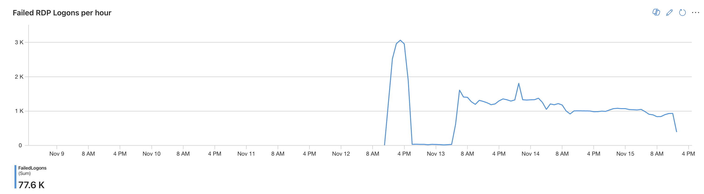

**Tools:** Microsoft Sentinel · Log Analytics · KQL · Azure Monitor Agent / Data Collection Rules · Azure Virtual Machines · Sentinel Workbooks · MITRE ATT&CK

---

## Architecture

```
 Internet scanners / brute-force bots
              │  RDP (TCP 3389, open to Any by design)
              ▼
 ┌──────────────────────────────┐
 │ vm-honeypot                  │  Windows Server 2025, Standard B2s v2
 │ Mexico Central               │
 │ Azure Monitor Agent (AMA)    │
 └──────────────┬───────────────┘
                │  Data Collection Rule: "All Security Events"
                ▼
 ┌──────────────────────────────┐
 │ Log Analytics workspace      │  law-sentinel-lab, South Central US
 │ SecurityEvent table          │
 └──────────────┬───────────────┘
                ▼
 ┌──────────────────────────────┐
 │ Microsoft Sentinel           │  KQL hunting · scheduled analytics rule
 │                              │  incidents · workbook
 └──────────────────────────────┘
```

The VM and workspace are in different regions because the Azure for Students subscription only allows a few regions, and the VM sizes I needed had no quota in South Central US. The AMA forwards logs across regions, so the pipeline works the same way.

---

## Repository contents

| Path | What it is |
|---|---|
| [`queries/`](queries/) | The 8 KQL queries used for hunting, detection, investigation, and the workbook |
| [`analytics-rules/rdp-brute-force-rule.json`](analytics-rules/rdp-brute-force-rule.json) | ARM template export of the tuned scheduled analytics rule, deployable to any Sentinel workspace |
| [`screenshots/`](screenshots/) | Evidence from each phase of the lab |

---

## Build steps

1. **Workspace and Sentinel.** Created a resource group and Log Analytics workspace, then enabled Microsoft Sentinel on it (31-day free trial: up to 10 GB/day of ingestion at no cost).
2. **Honeypot VM.** Deployed a Windows Server VM with a public IP and the NSG allowing RDP (3389) from any source. I chose a non-default admin username and a long, unique password.
3. **Log collection.** Installed the *Windows Security Events* solution from Content hub and created a Data Collection Rule through the *Windows Security Events via AMA* connector. Creating the rule installs the Azure Monitor Agent on the VM automatically.
4. **Verified ingestion.** Confirmed with `SecurityEvent | take 10` that events from the VM were arriving.

   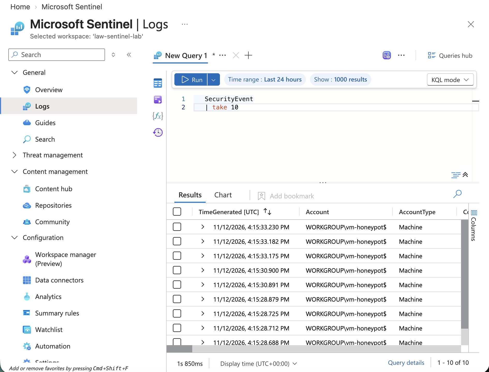

5. **Tested the detection path.** Made a few deliberately failed RDP logons from my own machine and confirmed they showed up as Event ID 4625. In the first hour, an unknown external scanner had already found the VM and tried the username `Test`. My own IP is redacted in the screenshot.

   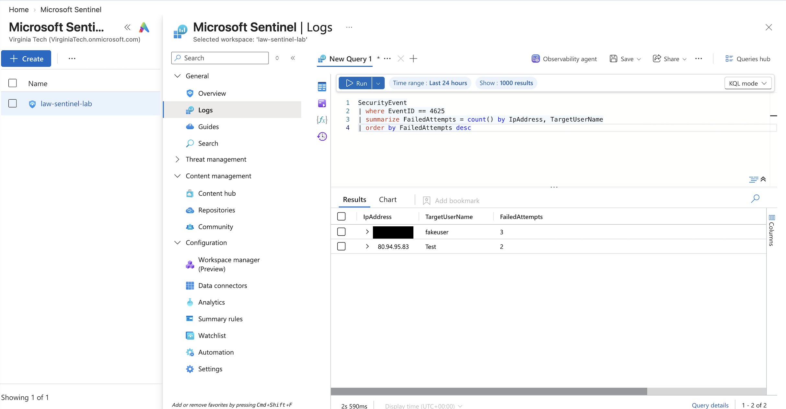

---

## Detection: scheduled analytics rule

| Setting | Value |
|---|---|
| Name | RDP Brute Force - Excessive Failed Logons |
| Logic | [`03-rdp-brute-force-detection.kql`](queries/03-rdp-brute-force-detection.kql): any source IP with **5 or more** failed logons (4625) |
| Schedule | Runs every 1 hour, looking back 1 hour |
| Severity | Medium |
| MITRE ATT&CK | Credential Access · **T1110** Brute Force · **T1110.001** Password Guessing |
| Entity mapping | IP → `IpAddress` |
| Incident grouping (after tuning) | Alerts grouped into one incident when all entities match, within a 24-hour window |

Before I saved the rule, a test run of its query caught a live attack: **94.26.88.52** with 140 failed logons in about 5 hours, cycling through `user`, `admin`, `pc`, and `administrator`.

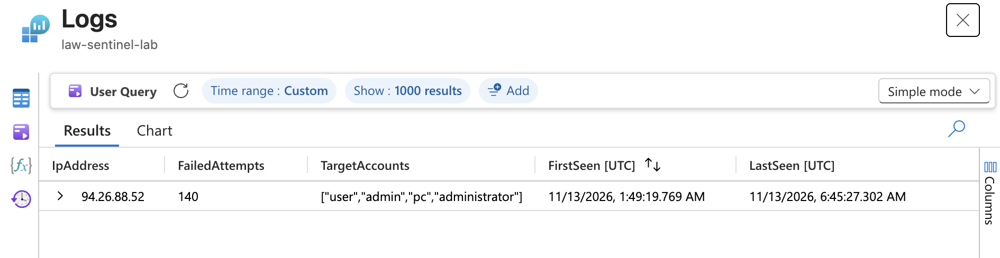
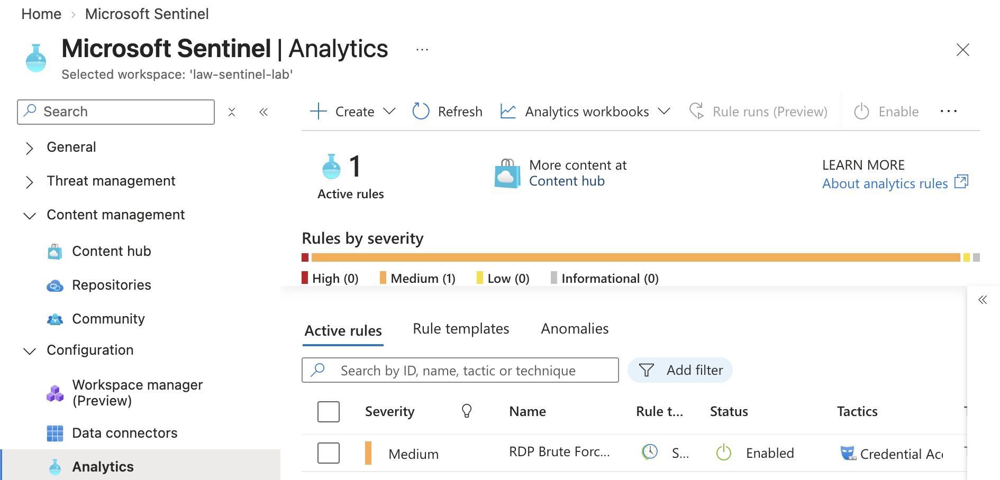

### Tuning: fixing alert fatigue

The first version created a **new incident for every attacking IP, every hour**. By the next afternoon the queue held **42 open incidents**, many of them repeats from the same IP. Sentinel's own *Similar incidents* panel flagged them as duplicates.

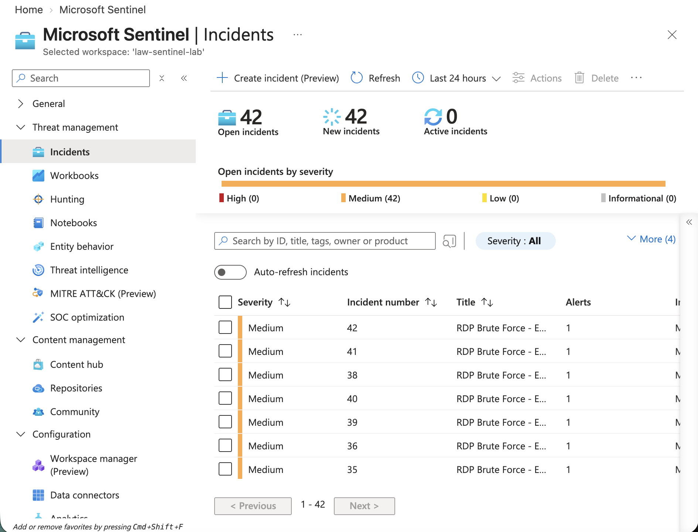

**Fix:** I enabled alert grouping (match on all entities, 24-hour window, closed incidents not reopened). Now each attacker produces **one incident per day**, and new alerts are added to it. The exported rule in [`analytics-rules/`](analytics-rules/) is the tuned version (`"groupingConfiguration": { "enabled": true, "lookbackDuration": "P1D", "matchingMethod": "AllEntities" }`).

---

## Investigation

I worked an incident the way a SOC analyst would:

1. **Reviewed the incident.** Incident #42 had one alert, mapped to Credential Access, with the attacker IP as its entity.

   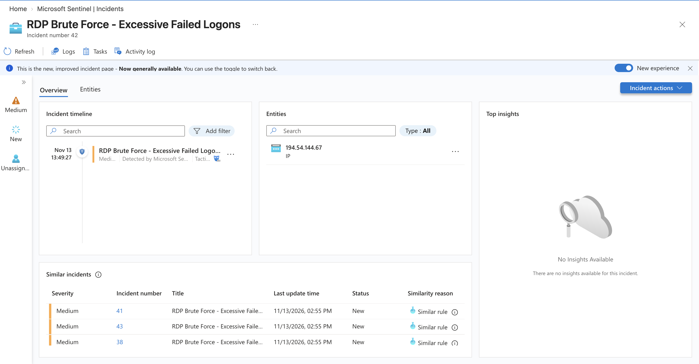

2. **Checked for compromise.** The key question for any brute-force alert is whether the attacker eventually got in. I searched for successful network or RDP logons (Event ID 4624, LogonType 3/10) from any external IP across the VM's full lifetime ([`04-successful-remote-logons.kql`](queries/04-successful-remote-logons.kql)). **The result was empty, so no attacker logged on.**

   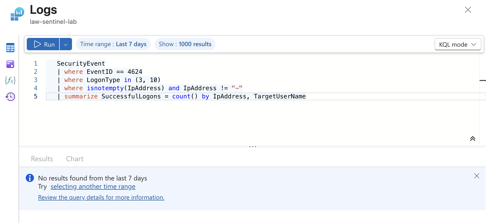

3. **Classified and closed.** I closed the incident as **True Positive – Suspicious activity** with the comment: *"Automated RDP password guessing. No successful logon (no 4624 events from any attacker IP over the VM's lifetime). Exposure is an intentional honeypot; no further action."*

   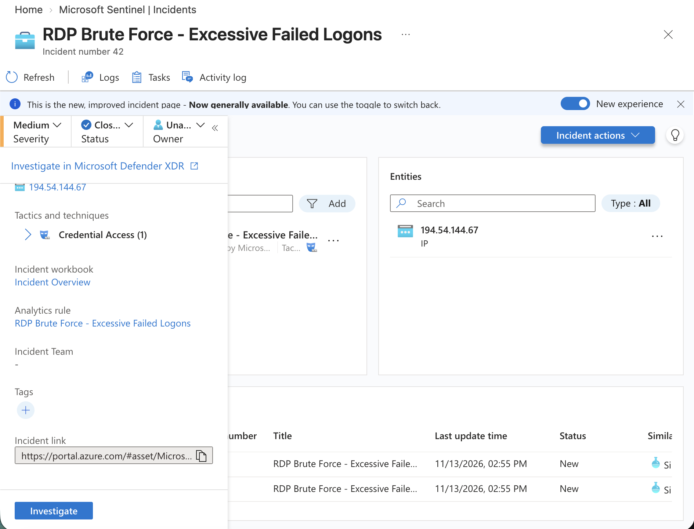

4. **Cleared the queue.** I bulk-closed all 47 incidents generated before tuning with the same classification, bringing the queue to zero.

   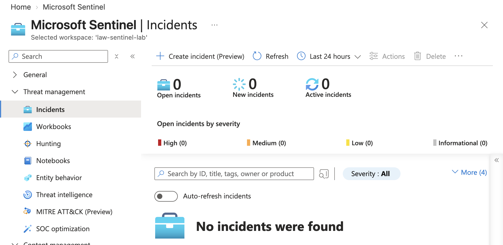

---

## Findings

### Volume and timing

| Snapshot | Failed logons | Unique source IPs | Usernames tried |
|---|---|---|---|
| ~28 hours in (Nov 13) | 26,748 | 15 (14 external + my own test) | 24 |
| ~3 days in (Nov 15) | **77,600+** | — | — |

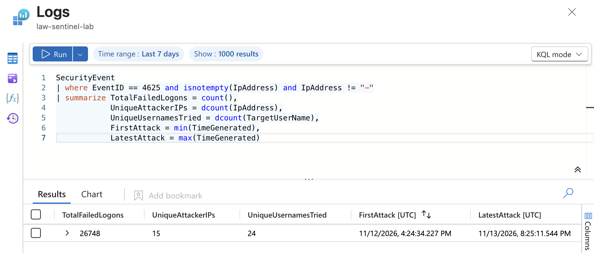

- **The first external attack arrived within about an hour** of the VM going live. Nothing advertised the VM; it was found purely by internet-wide scanning.
- Attacks came in **waves**. One burst peaked near **3,000 attempts/hour** on the afternoon of Nov 12 and then stopped entirely overnight. Starting the morning of Nov 13, a steady **900–1,600 attempts/hour** continued without a break through the end of collection.

### Attackers

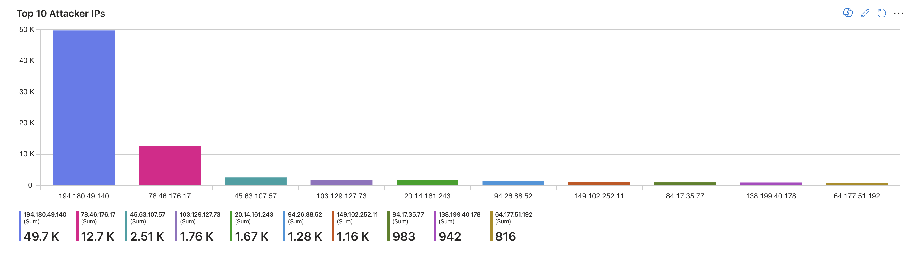

- **A single IP, 194.180.49.140, made 49,700 attempts, about 64% of all traffic.** The second-busiest IP made 12,700, and everything else was under 2,600 each. Most of the volume came from one aggressive automated tool, with a long tail of lighter scanners behind it.

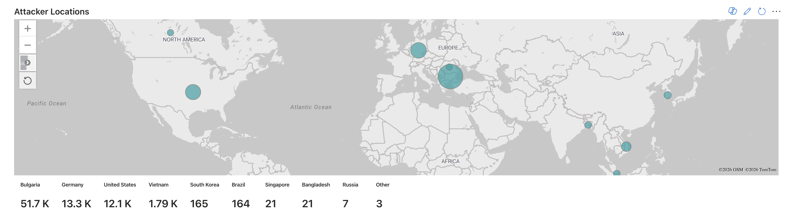

| Country (source IP geolocation) | Attempts |
|---|---|
| Bulgaria | 51.7K |
| Germany | 13.3K |
| United States | 12.1K |
| Vietnam | 1.79K |
| South Korea, Brazil, Singapore, Bangladesh, Russia, other | < 200 each |

> **Attribution caveat:** IP geolocation shows where the attacking *server* is hosted, not where the person behind it is. Brute-force traffic overwhelmingly comes from rented VPS/cloud hosts, compromised machines, and VPN exits, so "Bulgaria" means a server in Bulgaria, not necessarily a Bulgarian attacker.

### Usernames

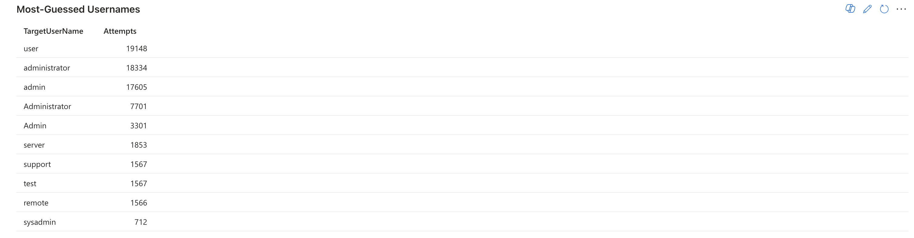

- `user` (19,148), `administrator` (18,334), and `admin` (17,605) account for **about 71% of all attempts**. With their capitalized variants (`Administrator` 7,701, `Admin` 3,301), the default-admin family reaches about **85%**.
- The tools also tried service-style names (`server`, `support`, `test`, `remote`, `sysadmin`, `itadmin`, `vmadmin`, `adminuser`, `vm_user`).
- **The lab's actual admin account was never guessed once.** Every attempt targeted names that didn't exist on the VM.

---

## Lessons learned and hardening

What a real environment should do instead of exposing RDP:

1. **Never expose RDP (3389) to the internet.** This VM was found in under an hour and received ~1,000 attempts/hour around the clock. Use **Azure Bastion**, **Just-in-Time VM access** (Defender for Cloud), or a VPN, and restrict the NSG source to known IPs.
2. **Avoid default or guessable admin names.** About 85% of attempts targeted `user`, `admin`, and `administrator` variants. A non-default username defeated all of them here.
3. **Enforce account lockout and strong, unique passwords,** and use MFA wherever remote access is required.
4. **Tune detections before they ship.** An untuned hourly rule produced 42 incidents in under a day. Grouping alerts by entity cut that to one incident per attacker per day without losing any signal.
5. **Brute-force alerts need a follow-up question:** *did anything succeed?* Pairing the 4625 detection with a 4624 check is what turns an alert into a conclusion.
6. **Detections as code.** The rule is exported as an ARM template, so it can be version-controlled, reviewed, and redeployed, the same approach I used for the network in my [Azure Network Hardening Lab](https://github.com/avestaz12).

---

## Reproducing this lab

1. Create a resource group, a Log Analytics workspace, and enable Microsoft Sentinel.
2. Deploy a Windows VM with RDP open to the internet. Use a non-default username and a strong password, and set a budget alert.
3. Content hub → install **Windows Security Events** → **Windows Security Events via AMA** → create a DCR targeting the VM with *All Security Events*.
4. Run the queries in [`queries/`](queries/).
5. Deploy the rule: **Sentinel → Analytics → Import** → [`analytics-rules/rdp-brute-force-rule.json`](analytics-rules/rdp-brute-force-rule.json).
6. Build the workbook from queries 02, 06, 07, and 08.
7. **Tear down:** delete the resource group so the VM, workspace, and Sentinel stop billing.

**Cost:** The Sentinel free trial covered ingestion. The VM ran on Azure for Students credit for a few dollars total.
